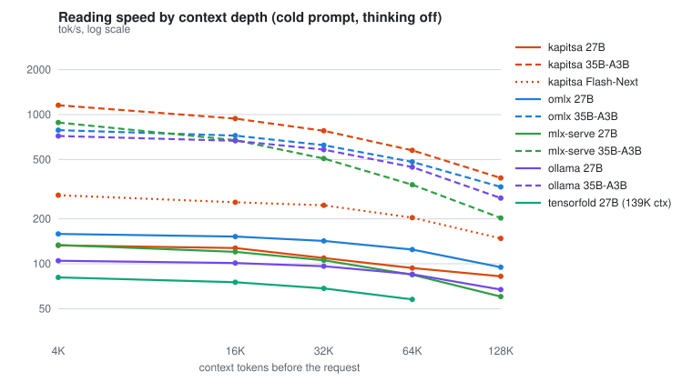
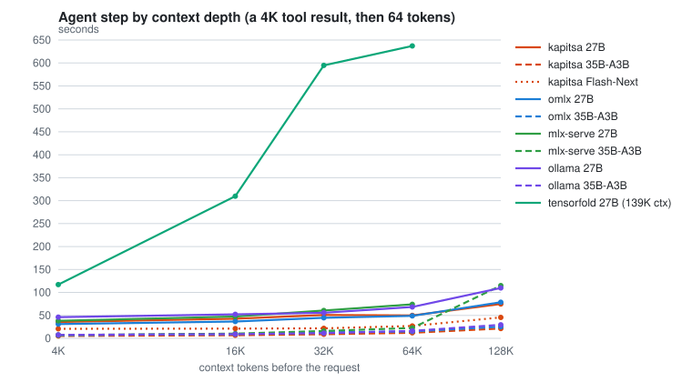

# benchcode

**How fast, how deep, how reliable is a local model for agent work? One command, one table.**

benchcode is a single Python file you point at a local model server. It measures what a coding
agent would feel on that stack, the model, the runtime and the hardware together, and prints one
table: speed and cache behaviour at every context depth the window allows, recall at depth, the
real window, tool-call fidelity, thinking mode, an eight-step agent session, compaction, sustained
speed and memory.

It talks only to the server's OpenAI-compatible endpoint and to macOS. Nothing in it depends on
which engine answers. It has run unchanged against [Kapitsa](https://github.com/nace-ai/kapitsa),
[oMLX](https://github.com/jundot/omlx), [mlx-serve](https://github.com/ddalcu/mlx-serve) and
[Ollama](https://ollama.com).

```
git clone https://github.com/swkpku/benchcode
cd benchcode
python3 benchcode.py http://127.0.0.1:8000
```

Requirements: macOS on Apple silicon, Python 3.9 or newer, no packages. The server must already be
running; benchcode never starts, stops or switches models.

## Why

A tokens-per-second figure from a 4K prompt says little about an agent session. Agents read tool
results on top of a context that grows to 60K or 80K tokens, they depend on the server's prefix
cache holding between turns, their tool calls must parse, and when the context fills the harness
asks for a summary and starts over. benchcode measures each of those on the stack you have, with
the same prompts for every server, so the numbers compare.

## What one run prints

```
  ╭──────────────────────────────────────────────────────────────────────────╮
  │  qwen3.6-35b-a3b  ·  MLX affine 4-bit, group 64             ● deep run  │
  │  MacBook Pro  ·  M1 Max 32-core GPU  ·  64.0 GB                         │
  │                                                                          │
  │  Writing    145 tok/s  T = 0.6   ·   159 tok/s  greedy                   │
  │                                                                          │
  │                    4K      16K      32K      64K     128K  context       │
  │  Reading         1155      940      779      576      376  tok/s         │
  │  Follow-up       0.08     0.10     0.13     0.17     0.30  s             │
  │  Writing          183      122        –     75.7     60.4  tok/s         │
  │  Agent step       5.1      6.7      8.9     12.1     21.4  s             │
  │  Recall           3/3      3/3      3/3      3/3      3/3                │
  │  Memory          22.4     23.1     24.3     26.0     29.3  GB            │
  │                                                                          │
  │  Window     262K declared  ·  tested to 128K                             │
  │  Session    8 x 8K results  ·  18.7 s a step  ·  2.7 min  ·  13K -> 80K  │
  │  Compaction 21.1 s at 80K  ·  1,421-token summary  ·  next turn 3.33 s   │
  │  Cache      follow-up hit  ·  new question hit  ·  survives others       │
  │  Tool calls 10/10 valid  ·  round trip ok                                │
  │  Thinking   on by default, switched off                                  │
  │  Memory     30.4 GB peak  ·  idle 20.4 GB                                │
  │  Sustain    +2% over 5 min  ·  thermal fair -> fair                      │
  │                                                                          │
  │  Conditions AC power 100%  ·  automatic power mode  ·  thermal fair      │
  │             no other process over 20% CPU  ·  elapsed 24.9 min           │
  ╰──────────────────────────────────────────────────────────────────────────╯
```

Above the box, each row prints as it is measured, with a note on what it did and what it found.
Below it come two labelled projections, any INVALID verdicts, flags, and the path of the JSON row
saved in `results/`.

## The rows

| Row | What is measured |
|---|---|
| First request | A 1K prompt, three times: the first-request penalty |
| Thinking | Does the model reason by default, does the switch turn it off, how much of the output is reasoning |
| Writing | Tokens per second on a 512-token answer, median of five runs, sampled at T 0.6 and greedy |
| Reading | A cold prompt of 4K, 16K, 32K, 64K and 128K tokens: prompt tokens per second |
| Follow-up | Three short turns on the cached document: seconds to the first token, and whether the cache hit |
| Writing at depth | The writing test again on top of the document |
| Agent step | A 4K tool result appended to the cached document, then 64 tokens: seconds, end to end |
| Recall | Three facts planted in the document, asked in one request |
| Memory | The server's footprint at each depth |
| Window | What `/v1/models` declares, the depth tested, and whether the server rejects or truncates past it |
| Cache survival | A new question on the same prefix from another conversation; the prefix after an unrelated conversation |
| Tool calls | Ten prompts that each call for one tool: well-formed structured calls, a round trip, a forced choice, one call with thinking on |
| Protocol | Usage in streams, finish reasons, what happens when a tool call is cut by the output cap |
| Agent session | A 12K system prompt with the tool list, then up to eight scripted steps that each append an 8K tool result: time per step, prefix reused, well-formed replies |
| Compaction | Where the session ended: the summary request, then the first turn of the conversation rebuilt from the summary |
| Default thinking | Tool calls, session and compaction again with no thinking switch sent, reasoning tokens counted: what a harness gets if it leaves the server's default |
| Sustain | Writing for three or five minutes: drift, thermal state, and the end rate against the fresh one |

Every speed row runs with thinking switched off, by both known switches, so each stack does the
same work. The default-thinking rows are the exception, by design.

## Modes

| Flag | Depths | Session | Sustain | Time on an M1 Max |
|---|---|---|---|---|
| `--quick` | 4K, 16K | none | none | 9 to 13 min |
| none | to 32K, then 64K and 128K if the measured reading rate predicts they fit 15 min | fitted to 10 min | 3 min | 30 to 45 min |
| `--deep` | every depth to three quarters of the declared window | 8 steps | 5 min | 25 to 120 min |

Other flags: `--model ID` when the server lists more than one, `--json` to print the row on stdout,
`--out FILE` to choose where it is saved. The API key, if the server wants one, is read from
`BENCH_API_KEY`.

## Results: nine stacks on one Mac

MacBook Pro M1 Max, 32-core GPU, 64 GB, macOS 26.5.1, 2026-11-09, `--deep`, one run per pair,
thinking off. Kapitsa 0.2.31, oMLX 0.7.4, mlx-serve 26.11.2, Ollama 0.35.1, each started with its
default settings. Qwen3.8 27B and Qwen3.6 35B-A3B are 4-bit builds on every server except oMLX,
whose 35B is 8-bit. The rows, the JSON and the full table are in
[`docs/runs/2026-11-09-m1-max`](docs/runs/2026-11-09-m1-max/summary.md).

<picture>
  <source media="(prefers-color-scheme: dark)" srcset="docs/assets/reading-dark.svg">
  
</picture>

<picture>
  <source media="(prefers-color-scheme: dark)" srcset="docs/assets/agent-step-dark.svg">
  
</picture>

| | Kapitsa 27B | Kapitsa 35B | Kapitsa Flash | oMLX 27B | oMLX 35B | mlx-serve 27B | mlx-serve 35B | Ollama 27B | Ollama 35B |
|---|---|---|---|---|---|---|---|---|---|
| Writing T=0.6, tok/s | 63.2 | 145 | 26.7 | 36.7 | 83.0 | 43.7 | 99.0 | 23.6 | 78.3 |
| Reading 4K, tok/s | 133 | 1155 | 288 | 159 | 786 | 133 | 884 | 105 | 719 |
| Reading 128K, tok/s | 82.4 | 376 | 148 | 94.8 | 327 | 60.3 | 203 | 67.1 | 276 |
| Follow-up 128K, s | 0.80 | 0.30 | 0.52 | 3.63 | 1.39 | 2.12 | 72.9 | 1.52 | 0.94 |
| Agent step 4K, s | 35.7 | 5.1 | 20.8 | 31.1 | 6.9 | 38.2 | 7.2 | 46.2 | 7.5 |
| Agent step 128K, s | 74.9 | 21.4 | 45.6 | 78.8 | 25.4 | refused | 115 | 110 | 29.6 |
| Session step, median s | 86.3 | 18.7 | 45.4 | 80.9 | 24.6 | 121 | 33.2 | 107 | 23.2 |
| Session, 8 steps to 79K, min | 13.5 | 2.7 | 6.9 | 12.3 | 3.5 | 19.7 | 5.2 | 16.7 | 3.6 |
| Compaction at 79K, s | 75.0 | 21.1 | 97.9 | 96.6 | 197 | 272 | 295 | 212 | 49.2 |
| Conversation cached at compaction | 100% | 100% | 100% | 100% | 15% | 92% | 16% | 92% | 92% |
| Next turn after compaction, s | 20.8 | 3.3 | 57.9 | 22.8 | 3.9 | 64.4 | 11.8 | 70.2 | 10.6 |
| Recall, five depths | 15/15 | 15/15 | 15/15 | 15/15 | 15/15 | 15/15 | 15/15 | 15/15 | 15/15 |
| Tool calls well-formed | 10/10 | 10/10 | 10/10 | 10/10 | 10/10 | 10/10 | 10/10 | 10/10 | 10/10 |
| Forced tool choice | honoured | honoured | honoured | ignored | ignored | honoured | honoured | ignored | ignored |
| Prefix after another conversation | kept | kept | lost | kept | kept | kept | kept | kept | kept |
| Memory peak, GB | 44.4 | 30.4 | 49.8 | 46.5 | 47.3 | 51.2 | 31.9 | 60.2 | 58.7 |
| Valid | yes | yes | yes | yes | yes | yes | yes | no | yes |

What the run showed:

- The 35B-A3B is the agent model for a 64 GB Mac. On every server it reads four to eight times
  faster than the 27B and finishes the eight-step session in 3 to 5 minutes against 12 to 20.
- Among the 27B stacks Kapitsa led on writing, follow-up and session step; oMLX read faster at
  every depth with slower follow-ups; mlx-serve and Ollama were the slowest and the only ones that
  refused or broke at 128K.
- Two servers lost the cache before compaction. With 15 to 16 percent of the conversation cached,
  the summary took 197 s and 295 s instead of 21 to 49 s.
- Ollama 27B is INVALID under the protocol: at 128K the answer contained a `</think>` tag with
  thinking off. Its rows to 64K measured normally.
- mlx-serve's server default is thinking off, where the other three follow the model template
  and think at the highest effort.

One run per pair. Each configuration was its default. These are measurements of one machine on one
day, not a ranking.

## Method

- **Protocol.** Where a row also exists in Kapitsa bench (writing, reading, follow-up, sustain,
  memory, conditions) benchcode follows `bench/harness/bench.py`: the same frozen corpus, the same
  slices, a random nonce after the system tag on every cold prompt, explicit sampling (T 0.6,
  top_p 0.95, top_k 20), thinking off by both `chat_template_kwargs.enable_thinking=false` and
  `reasoning_effort=none`, a per-conversation `X-Session-Id`, the middle-window decode rate, median
  of five writing runs. The reading prompt carries three planted lines for the recall row and is
  shortened by their length, so it has the same character count as Kapitsa's but is not
  byte-identical. The other rows are benchcode's own.
- **Validity.** A cold prompt that reports more than 16 cached tokens, reasoning returned with
  thinking off (unless the model cannot be switched off), or Low Power Mode makes the run INVALID.
  The partial result is still saved and says why.
- **No extrapolation inside the table.** Two projections are printed below it and labelled as such:
  the minutes a 12-turn task at 16K would take, and the re-read a harness pays when it compacts with
  a different system prompt and misses the cache.
- **Every row records** the model and quantization as `/v1/models` lists them, the declared and
  tested window, thinking state, sampling as sent, macOS version, machine, power source and mode,
  thermal state, swap, busy processes, corpus sha256 and date.
- **Surprises go in [`FAILURES.md`](FAILURES.md)**, one line each, and each becomes a check.

## Not now

GUI, Windows, Linux, vision, computer use, a live agent task, engine-specific endpoints, starting or
restarting servers, a context sweep that reloads the model. benchcode is not an agent and does not
choose a compaction policy; it measures compaction where the session ended.

## Layout

```
benchcode.py        the command
corpus/             Kapitsa bench's frozen corpus, unchanged (Apache-2.0 excerpts, see corpus/NOTICE.md)
docs/runs/          published runs: the printed table and the JSON row for each
docs/make_charts.py draws the README charts from result rows, standard library only
FAILURES.md         what stacks did that surprised us
CLAUDE.md           the project's rules
```

## License

Apache-2.0. The corpus is Kapitsa bench's, under its own notice in `corpus/NOTICE.md`.
